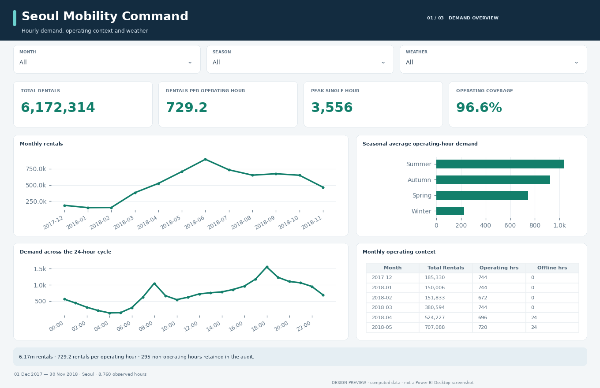
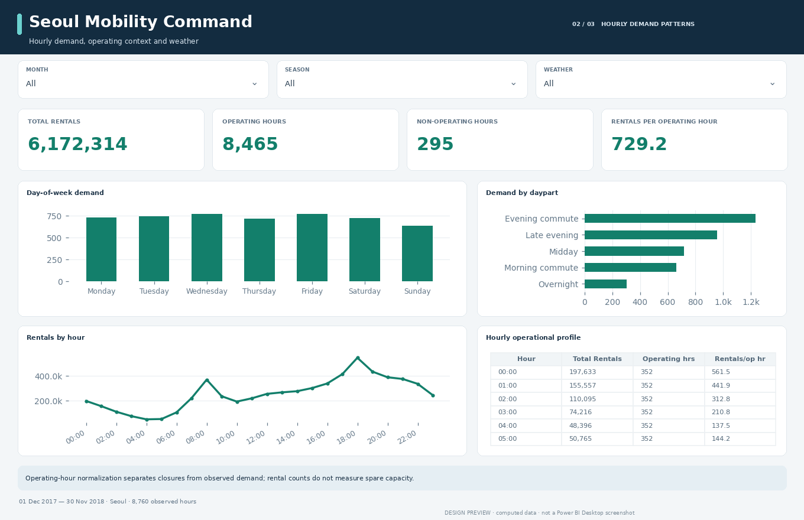

# Seoul Mobility Command

How does observed rental demand vary across operating hours, seasons and weather conditions?

An audited UCI data analysis and editable three-page Power BI report for mobility planners and operations analysts.

**Delivery status:** data cleaning, analysis and source-format checks complete. Power BI Desktop refresh, DAX/M execution and native rendering await verification. Images are computed design previews, not Desktop screenshots.

## Findings at a glance

| Metric | Audited snapshot |
| :--- | ---: |
| Total rentals | 6,172,314 |
| Recorded hours | 8,760 |
| Rentals per operating hour | 729.16 |
| Non-operating hours | 295 |

8,760 original records → **8,760 retained fact rows**. See the [analysis findings](analysis/FINDINGS.md) and [cleaning audit](analysis/cleaning_audit.json) for the complete accounting.

## Report experience

| Page | Interpretation |
| :--- | :--- |
| 01 · Demand overview | 6.17m rentals · 729.2 rentals per operating hour · 295 non-operating hours retained in the audit. |
| 02 · Hourly demand patterns | Operating-hour normalization separates closures from observed demand; rental counts do not measure spare capacity. |
| 03 · Weather & data quality | Weather associations also reflect season and scheduling. Compare within a season before planning an intervention. |

Three report tabs move from an executive overview to segment detail and data quality. Dropdown slicers provide context; category charts expose the relevant record-count denominators through tooltips. Measures recalculate with filters except where an explicit definition documents otherwise. Tables rank by the first metric unless calendar order is required. Native slicer and selection behavior still requires Desktop testing.

| Segment detail | Quality and context |
| :---: | :---: |
|  |  |

## Decisions this analysis supports

**Staffing scenarios.** Review the hourly demand profile within a chosen season. All 24 clock hours are observed; operating-hour denominators avoid treating closures as weak demand.

**Seasonal planning.** Compare complete monthly rental counts alongside operating coverage. June 2018 has the largest monthly total: 896,887 rentals.

**Weather scenarios.** Compare rainy and dry periods within similar seasonal and operational contexts. Observed weather differences are confounded; they do not quantify the effect of changing weather alone.

## Analytical boundaries

This is one historical year for one city. No fleet size, station capacity, inventory or unserved requests are provided. Counts do not establish utilization or unmet need. Weather patterns and holiday differences are descriptive, not controlled effects.

Rates use explicit denominators; no targets, profit figures, forecasts or causal effects are invented. [Metric contract](docs/METRIC_CONTRACT.md) · [DAX definitions](docs/MEASURES.md) · [Data dictionary](data_dictionary.csv).

## Project contents

| Location | Purpose |
| :--- | :--- |
| `powerbi/Dashboard.pbip` | Power BI Desktop entry point |
| `powerbi/Dashboard.Report/` | Editable native report pages, visuals and theme |
| `powerbi/Dashboard.SemanticModel/` | Relationships, M imports and DAX measures |
| `data/raw/` | Unmodified source snapshot and provenance hashes |
| `data/clean/` | Cleaned fact and dimension tables |
| `analysis/` | Findings, grouped analysis, cleaning and validation audits |
| `docs/` | Metric contract, report guide and native review checklist |
| `scripts/` | Cleaning, report generation and integrity validation |

[Power BI setup](POWER_BI_SETUP.md) · [Report guide](docs/REPORT_GUIDE.md) · [Validation status](analysis/validation_report.json).

## Source and license

Dataset attribution and source links: [DATA_LICENSE.md](DATA_LICENSE.md). Code: MIT. Dataset: CC BY 4.0. This is a historical analytical portfolio project, not a live operational feed.

